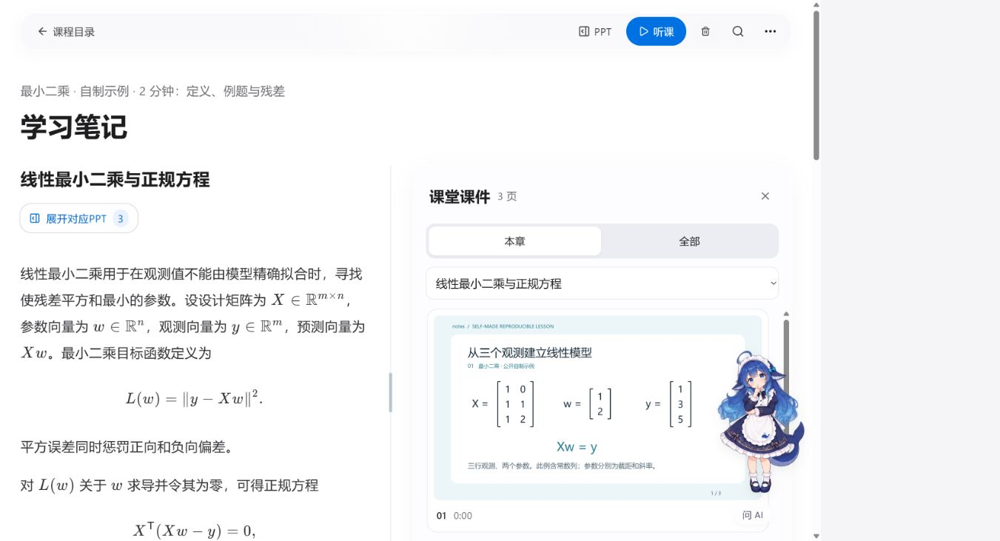

# notes

本地课程视频与可选原课件 → 本地字幕和课件精简 → 多模态 API 整理 → 可追溯的学习笔记。

[下载源码](https://github.com/Chenwt-max/notes/archive/refs/heads/main.zip) · [便携包发布页（待发布）](https://github.com/Chenwt-max/notes/releases) · [使用指南](docs/USER_GUIDE.md) · [架构说明](docs/ARCHITECTURE.md) · [已知限制](docs/LIMITATIONS.md)

当前公开的是源码，**Windows 便携包尚未发布**；候选目标版本为 1.0.0-rc.1。源码维护更新及验证边界见[更新记录](docs/UPDATES_20261024.md)。已有功能与本机验证结果随项目交付；独立干净 Windows、人工听写金标和未完成的界面异常状态保留为待验收，见[验收记录](docs/ACCEPTANCE.md)。

Windows 桌面浏览器应用。音频与视频留在本机，字幕本地转写；本地图像算法、YOLOX 遮挡辅助和 PaddleOCR-VL-1.6 筛选课件。主动整理时将字幕和精简后的课件原图发送到配置的多模态 API，直接读取文字和公式，并判断重复、非课件与动画终态。有限样本通过不代表所有课程零错误。



上图来自2分钟自制短课的实际提取、整理及反馈复核结果；合成语音示例不代表真实课堂准确率。

## Windows 便携使用

以下步骤适用于附件发布后。现在可先按“开发与回归”安装源码；请勿把未发布的便携包视为当前源码版本。

1. 从 Releases 下载全部 4 个 `.partNNN` 分卷、`release-manifest.json`、`merge-release.ps1` 和 `合并并解压.cmd`，放在同一目录，双击合并并解压入口。支持中文和空格路径，不要在压缩包中直接启动。
2. 双击 `notes.cmd`。无需另外安装 Python、Node 或 FFmpeg；NVIDIA GPU 路径仍需要系统显卡驱动。
3. 首次打开“准备本地模型”，下载并逐文件校验约 8.1 GiB 模型。可取消与续传；校验未完成不能开始新提取。
4. 在“设置”选择 CPU 或 NVIDIA GPU、线程和并发。听课优先保留低负载；快速模式没有固定节流休眠。
5. 新建课程，批量填写本机视频完整路径，每行一个。导入只记录路径，原视频不会复制或上传。创建任务时，课件来源可选“从视频自动提取”或“使用已有 PPT / PDF”；后者填写课件完整路径，跳过视频画面检测，直接使用文档页面。
6. 在设置中填写整理接口、模型、密钥及实际单价，再创建提取任务。默认每份笔记总上限 ¥1，整理、复核和整课分章累计计费；问答单独计费。

`停止 notes.cmd` 保存任务检查点后停止本目录的受管理实例；`重启 notes.cmd` 停止后重新启动。端口 8765 被其他目录或程序占用时会明确提示，不结束其他程序。创建桌面入口可运行 `scripts/create-desktop-shortcut.ps1`。

便携数据位置：`data/` 配置及账本，`outputs/` 学习资料，`models/` 模型，`cache/` 临时与第三方缓存。迁移程序时保留这些目录；课程原视频路径变化后需要重新导入。换 Windows 账户后请重新填写加密保存的 API 密钥，已有资料仍可阅读。

已有课件保留全部原页，不伪造视频时间戳。PDF文字层和PPTX可编辑Office Math可作为来源；公式结构最终由多模态 API 对照原页读取。默认课件栏使用筛选结果，“查看全部来源”可恢复全部文档页面。PPT/PPTX页面渲染需要本机PowerPoint或LibreOffice；没有Office时可先另存为PDF。

## 阅读与整理

完成整课素材提取后，依次整理、复核，再让接口依据完整成稿划分知识章节。内部 API 请求小段不作为阅读目录，也没有按 20 分钟提前发布的设置。

笔记页可拖动 PPT 分隔条并记忆比例，展开补充画面、打开高清来源、搜索和回看视频。播放支持倍速、全屏、隐藏笔记和跟随进度。六角色、所有静态姿态、玻璃轮盘、大小、拖动和定时切换均随项目分发；选文提问通过设置的同一接口，切换外观不产生接口调用。

失败整理可以在任务概览明确确认后重试一次，旧响应和累计账本保留；刷新和续跑不产生新的失败尝试。超时且计费未知时先核对供应商账单，在页面填写实际费用后再明确重试。无法唯一定位的复核修订不应用，保留原稿。

## 开发与回归

Python 3.11.9，Node 24.15.0，FFmpeg。三套依赖分别锁在 `requirements-lock.txt`、`requirements-asr-lock.txt`、`requirements-formula-lock.txt`。便携运行时实际包版本另记于 `runtime-locks.json`，不使用开发虚拟环境的 Python 启动器。

```powershell
python -m venv .venv
.venv\Scripts\python.exe -m pip install -r requirements.txt -c requirements-lock.txt
npm ci --prefix frontend
npm run build --prefix frontend
.venv\Scripts\python.exe -m pytest tests -q
node tests/ui/run.mjs
```

完整模型环境及便携构建参见 [开发与交付](docs/DELIVERY.md)。公开测试生成自制视频夹具，不读取个人课程。CI 配置会在上传后的 GitHub 仓库运行；本地通过不冒称远端 CI 已通过。

## 文档与授权

- [使用指南](docs/USER_GUIDE.md)
- [架构与算法](docs/ARCHITECTURE.md)
- [交付与首次准备](docs/DELIVERY.md)
- [验收与发布门槛](docs/ACCEPTANCE.md)
- [实际页面补测](docs/LIVE_UI_ACCEPTANCE.md)
- [干净 Windows 待验收清单](docs/CLEAN_WINDOWS_ACCEPTANCE.md)
- [公开界面演示与可复现的2分钟自制短课](docs/demo/README.md)
- [已知限制](docs/LIMITATIONS.md)

项目代码为 [MIT](LICENSE)；六角色图片分发授权另见 [图片授权](frontend/public/assistants/ASSET_LICENSE.md)，第三方依赖遵循各自许可证，见 [来源说明](THIRD_PARTY_NOTICES.md)。本项目附带的自制示例用于演示，不代表真实课程内容或模型准确率评测集。
