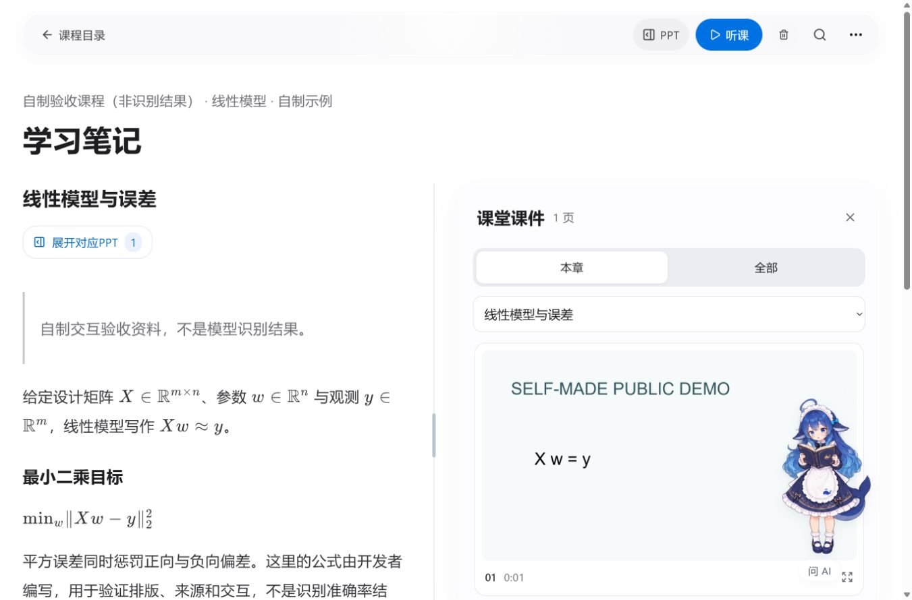

# 实际页面交互补测

使用实际 Windows 便携 ZIP 解压目录启动服务，在浏览器执行真实点击、输入、拖动、刷新、视频播放和下载。资料库是明确标注的开发者自制夹具，视频为 6 秒测试画面；本次补测不评价模型识别准确率，也未向供应商发送付费请求。

## 已完成路径

49 项通过记录覆盖：首次准备返回、名言点击、课程创建与空名称保护、原位改名保存/取消、中文空格路径批量导入、非法路径提示、课时排序/移动/改名、笔记数学渲染、搜索空结果及恢复、PPT 分栏鼠标/键盘调整与刷新记忆、原视频 640×360 原图及 1:1、六角色 36 姿态、大小恢复、15 秒同角色定时切换、助手移动缩放、选文携带引用、未配置接口禁止发送、倍速/隐藏笔记/全屏/上一下一段、重复处理确认、课件过滤、非法公式拒绝保存、来源记录、字幕搜索和视频跳转、两类 ZIP 实际下载、本地素材核验、资源/预算/动效持久化、空缓存禁止清理、自制课程删除、缺模型禁止启动，以及畸形API地址拒绝保存且刷新后配置未改变。

设置中暂改预算为 ¥1.25，刷新确认后恢复 ¥1；临时改变听课模式与线程后恢复 CPU、快速模式、2 线程、课程并发 1。没有改动原开发资料库、模型、历史费用账本或真实课程。

## 发现并修复

- 模型未准备时刷新已有笔记会被首次准备引导覆盖。现在仅在初始首页执行引导，并核对导航尚未改变。
- 新建课程在刷新目录前导航，短暂显示课程不存在。现在等目录刷新完成后才进入新课程；添加课时同样等待。
- 助手定位使用含滚动条的窗口宽度。现在按可用宽度约束，并观察可用宽度变化。
- API基础地址按实际主机/协议校验，不能把含账号段的远程HTTP地址误认成本机地址；拒绝缺主机、畸形端口、查询参数及片段，不发出试探请求。

前两项有独立启动回归；助手边界在组件中使用可用宽度小于窗口宽度的夹具先复现旧失败，再验证修复。构建与组件测试通过，CI 包含新增用例。

随后修复入场动效的父容器变换：标题保留动效，屏幕固定工具不再继承临时变换。默认动效下4次进入，边缘助手始终在可用宽度内。费用显示补测覆盖未知单价不省略、微小正费用不显示为零，后者通过组件夹具核验。

## 本机HTTP与恢复夹具

额外3次问答请求仅发送到127.0.0.1的自制模拟接口，没有供应商调用：未知价格显示“本次费用未知”；按1000输入/800输出token及1/2元每百万的模拟单价显示¥0.0026；空choices响应保留预留、不自动重试。模拟费用不计入真实API开支，原课程账本未改变。测试结束已关闭模拟接口并恢复隔离配置。

使用独立自制未确认账目验证：核账前重试禁用，填0后确认旧预留被保留在历史字段；取消失败重试不创建新尝试；单份任务额度改为¥0.9后刷新保留，再恢复¥1。未排队或执行识别任务。原始成稿保留，临时恢复场景文件在测试后复原。

早期记录保留三项历史观察：修复前深链失败、未满 15 秒的姿态观察、误读取 checkbox 的 aria 属性。后两项纠正测试方法后通过，不当作程序缺陷。

## 页面与尺寸

29 个已走访页面分别在 1366、1920、2560 宽度检查，共 87 个组合。包含课程、记录、笔记、播放、课件详情、OCR、公式、来源、核验、导出、新任务、首次准备和全部设置分层。稳定布局未出现空白标题或横向溢出。

尺寸边界测量通过真实设置开启减少动效，完成后恢复；实际鼠标拖动、助手开合与定时切换也在默认动效模式核验。上述结果不代表任意浏览器缩放级别或所有错误状态全覆盖。

下图为实际便携服务中的自制交互夹具，不是课程识别成果：

## 保留待验收

干净 Windows 机器不可用，按用户要求保留待验收。下载中断、未知计费、失败重试、运行中删除等已由组件、后端和原生进程回归验证；尚未将所有故障逐项在浏览器内手工触发。真实字幕人工逐字金标与远端 GitHub CI 仍未完成。正式公开上传仍需最终确认。
